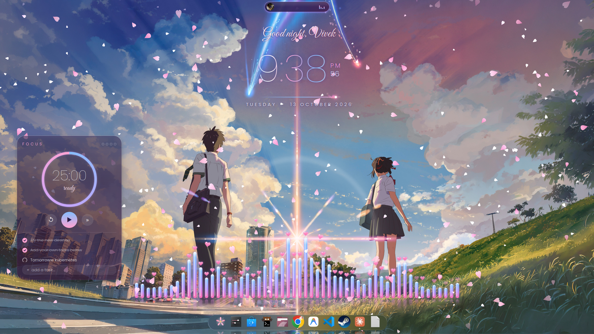
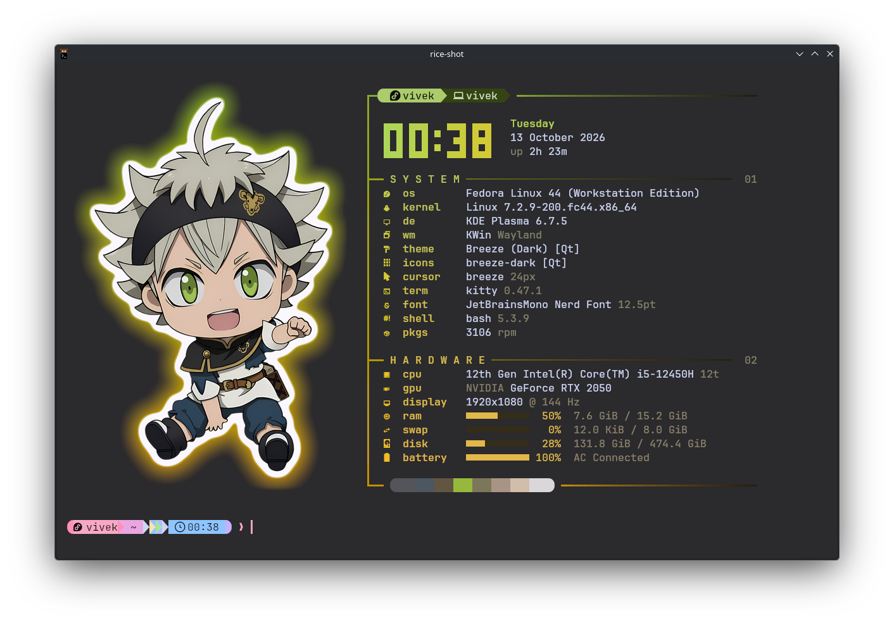
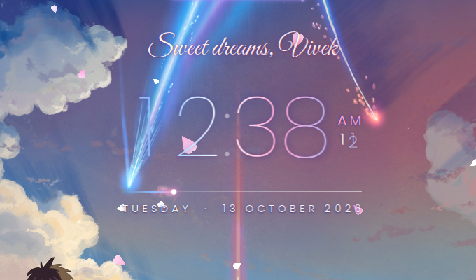
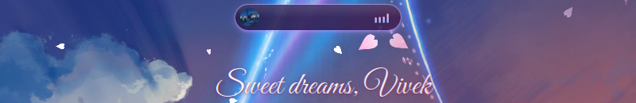
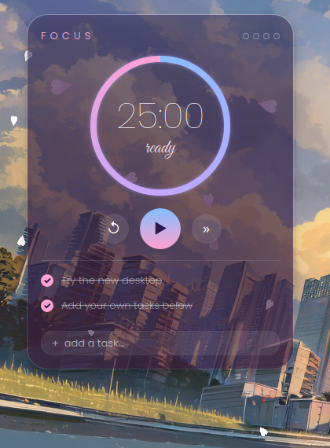
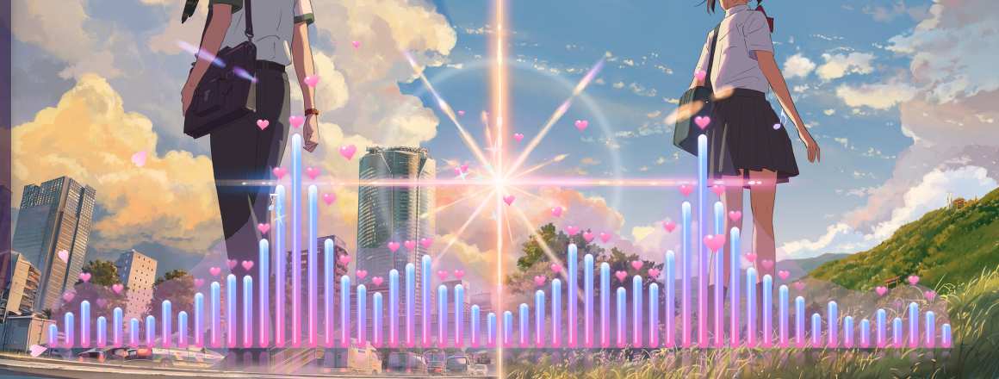
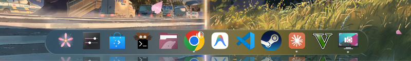

# 🌸 Linux Customizations — Fedora 44 · KDE Plasma 6

An anime-themed (*Kimi no Na wa* / sakura) setup for **Fedora 44 KDE Plasma 6.7**: a kitty terminal with
picture logos, fish-style autosuggestions and modern CLI tools, plus a desktop with an animated comet clock,
an iPhone-style Dynamic Island, falling sakura petals, a **music visualizer built into the wallpaper**,
a Pomodoro widget and a macOS-style zoom dock.

Most desktop pieces are **custom QML widgets written for this setup**. They aren't downloaded from anywhere and are all in this repo.
One command installs everything, and one command undoes it.



<p align="center">
  
</p>

---

## Contents

- [Quick install](#-quick-install)
- [What you get — Terminal](#-terminal)
- [What you get — Desktop](#-desktop)
- [Cheat-sheet](#-cheat-sheet)
- [Customizing](#-customizing)
- [Uninstall](#-uninstall)
- [Repository layout](#-repository-layout)
- [Troubleshooting](#-troubleshooting)
- [Credits & licenses](#-credits--licenses)

---

## 🚀 Quick install

```bash
git clone https://github.com/vivek1234-byte/Linux_Customizations_Fedora44_KDEPLASMA.git
cd Linux_Customizations_Fedora44_KDEPLASMA
./install.sh
```

| Option | Does |
|---|---|
| `./install.sh` | terminal **and** desktop (asks before each big step) |
| `./install.sh --terminal` | only the terminal part |
| `./install.sh --desktop` | only the desktop part |
| `./install.sh --yes` | no questions, defaults everywhere |

The installer:

1. installs packages with `dnf` (asks for your **sudo** password),
2. installs tools that Fedora doesn't package (starship, yazi, ble.sh, JetBrainsMono Nerd Font) into `~/.local`,
3. **backs up every file it replaces** to `~/.local/share/kde-rice/backup-<date>/`,
4. copies the configs and widgets, asks for **your name** (clock greeting) and **a wallpaper picture**,
5. restarts plasmashell once and places the widgets (the screen flickers for a second).

Then open a **new kitty window**.

> **Pictures are not included.** The wallpaper and the anime pictures in the screenshots are copyrighted, so bring your own:
> any wallpaper works (the screenshots use a *Kimi no Na wa* comet wallpaper), and for the terminal logo put pictures in
> `~/Pictures/ff/` and run `ff-images` (see [fastfetch picture logo](#fastfetch-picture-logo)).

**Requirements:** Fedora 44 (or another Fedora/RPM distro), KDE Plasma 6.x on Wayland, bash, internet.

---

## 💻 Terminal

### kitty — `terminal/kitty/kitty.conf`
- **JetBrainsMono Nerd Font** 12.5 pt with ligatures, 14 px padding.
- **Translucent + blurred** background (opacity 0.88, blur 32). Change it live with `Ctrl+Shift+A` then `M` / `L`.
- Pink **beam cursor with a trail** (cursor_trail) that blinks smoothly (ease-in-out).
- Custom **Catppuccin-style palette** with a deep plum background `#0E0C10`, pink/lavender accents.
- **Powerline slanted tabs** on top, lavender active tab.
- Curly-underlined URLs, visual bell in lavender, no audio bell.
- `splits` + `stack` layouts; new windows/tabs open in the **current directory**.
- **Click the picture** in the fetch output to switch to the next picture (`ff_dclick.py` kitten).

### fastfetch picture logo
`remfetch` (`terminal/bin/remfetch`) → `ff-logo.py` + `design.py` (`terminal/fastfetch/`)

- Every new kitty window shows **fastfetch with a real picture** (kitty graphics protocol). Other terminals get a coloured text logo.
- Pictures come from a **shuffled queue**, so you see a different one each time.
- **9 intro effects** that rotate: fade, slide, zoom, pixel, wipe, glitch, dissolve, bloom, sparkle.
- **The colours adapt to the picture.** The clock, section headers and bars take their palette from the current image.
- **Sticker look:** white die-cut border plus a soft **neon glow** that follows the outline.
- Big digital **clock + date + uptime**, then a SYSTEM and a HARDWARE section with usage bars.
- **Resize-aware:** maximise or resize the window and the same picture is redrawn cleanly at the new size.
- `clear` also clears images and redraws the fetch.

**Adding pictures** (`ff-images` = `terminal/fastfetch/make-images.py`):
```bash
cp my-picture.png ~/Pictures/ff/
ff-images        # → ~/.config/fastfetch/images/my-picture.png
```
The pipeline upscales the picture 4× with **Real-ESRGAN (anime model)**, cuts out the background with **isnet-anime**,
boosts colour a little, trims it and adds the sticker border. It needs the optional "picture tools" step of the installer
(~400 MB). Without them you can still drop ready-made transparent PNGs into `~/.config/fastfetch/images/`.

Optional per-picture hints go in `~/Pictures/ff/<name>.json`. Examples are in `terminal/fastfetch/hints-examples/`:
`border: false` (no sticker border), `align: "left-center"`, `keep_all`, `strip_border`, `erase` / `erase_black` polygons.

### Prompt — Starship (`terminal/starship/starship.toml`)
Powerline-style prompt with pastel segments: OS icon → user → directory → git branch/status → language versions
(node, bun, c, rust, go, php, …) → time.

### bash — `terminal/bash/bashrc.d/aesthetic.sh` and `tools.sh`
| Feature | Tool | How to use |
|---|---|---|
| Fish-style **autosuggestions + syntax highlighting** | [ble.sh](https://github.com/akinomyoga/ble.sh) | type, then `→` to accept the grey suggestion |
| **History search** across all sessions, with stats | [atuin](https://atuin.sh) | `Ctrl+R` (Up-arrow keeps normal behaviour) |
| Smart `cd` | zoxide | `z part-of-dir` |
| Fuzzy finder (themed) | fzf | `Ctrl+T` files, `Alt+C` dirs |
| `ls` with icons + git status | eza | `ls`, `ll`, `la`, `lt` (tree) |
| `cat` with syntax highlighting | bat | `cat file` |
| **File manager** with image previews | [yazi](https://yazi-rs.github.io) | `y` (quit with `q` → shell moves into that folder) |
| Bigger history, case-insensitive completion, `autocd`, `cdspell` | bash | — |

### Other CLI tools
| Tool | Replaces | Example |
|---|---|---|
| **git-delta** | git's diff pager | `git diff`, `git log -p` → side-by-side, line numbers (also inside lazygit) |
| **tealdeer** (`tldr`) | `man` for quick examples | `tldr tar` |
| **dust** | `du` | `dust -d 1 ~` |
| **duf** | `df` | `duf` |
| **procs** | `ps` | `procs --sortd cpu` |
| **glow** | — | `glow README.md` (renders markdown) |
| **btop**, **lazygit** | — | system monitor, git TUI |
| **cava** | — | `cava` in a terminal: audio bars in the same pink → lilac → sky colours |

---

## 🖥 Desktop

### ☄️ Comet Clock — `desktop/plasmoids/com.vivek.cometclock`


- Handwritten greeting that follows the time of day: *Good morning / afternoon / evening / night / Sweet dreams, `<name>`*.
- Big thin digits that **roll** (old digit slides up, new one bounces in) when they change.
- The time has a **sky-blue → white → sakura-pink gradient** that slowly drifts, with a violet glow (stronger on hover).
- The colon **breathes**. AM/PM sits above rolling **seconds**.
- **Comet line:** a glowing dot crosses the line once a minute with a **sparkle particle tail**, like the comets in the film.
- Floating **star sparkles** (more on hover). Fades in on login.
- Fonts (Poppins + Great Vibes) are bundled inside the widget.
<br clear="right">

### 🏝 Dynamic Island — `desktop/plasmoids/com.vivek.island`


An iPhone-style pill at the top centre of the desktop that **only appears while music/video is playing**
(Spotify, browser, VLC… anything that speaks MPRIS).
- **Compact:** spinning round cover art + bouncing equalizer bars.
- **Expanded** (hover, click to pin, or automatically for 4 s when the track changes): scrolling title,
  artist · `0:30 / 4:25`, ⏮ ⏯ ⏭ buttons, gradient progress line.
- Indigo → plum glass with a lavender border and glow, matching the desktop theme.
- Pops in with a bounce. After a **pause it waits 8 s**, then fades away. When nothing is playing it's hidden.
- Click the art to bring the player window forward.

### 🏝 Tray Island — `desktop/desktoptheme/SakuraIsland`
The left system-tray panel wears the same look: an indigo → plum glass **pill** with a lilac rim, a soft
lilac glow and a glassy sheen. It auto-hides and slides in when the cursor touches the left screen edge.
This is a Plasma theme (Breeze with only `widgets/panel-background` replaced), so any panel that draws a
background gets the island skin; the dock keeps its own Wave Task skin.
The panel itself is set up by `desktop/layout/apply-layout.js`: left edge, 38 px thick, floating,
fit-to-content, centred, auto-hide, translucent, holding the app launcher (the
[Cutoff](https://github.com/galib-i/cutoff) launcher if installed from the KDE Store, otherwise Kickoff) and
the system tray. If you already have a left panel it is only restyled; otherwise one is created and the
tray + launcher move into it.
Colours and radius live at the top of `gen-panel-svg.py`; re-run it and re-apply the theme
(`plasma-apply-desktoptheme default && plasma-apply-desktoptheme SakuraIsland`).

### ⏳ Focus Garden — `desktop/plasmoids/com.vivek.focus`


- **Pomodoro** ring timer (25 min focus / 5 min break) with a glowing sky → lavender → pink ring.
- ↺ reset · ▶/❚❚ start-pause · » skip to break/focus.
- When a session ends: desktop **notification + sound + ring pulse**, then it switches mode.
- Dots in the corner = **sessions finished today** (reset daily).
- **To-do list:** type and press Enter to add, click the circle to tick it off (strikethrough), hover then ✕ to delete.
  Tasks are saved in the widget's config, so they survive reboots.
<br clear="right">

### 🌸 Sakura Breeze wallpaper — `desktop/wallpapers/com.vivek.sakura`
- Your picture plus **sakura petals falling gently from the top**: two depth layers (small faint far petals, bigger
  near petals), different tints, spinning and swaying softly. All petals fall at a calm, steady speed.
- **Battery friendly:** the petals pause while the focused window is maximised or fullscreen.
- Settings (right-click desktop → *Desktop and Wallpaper*): picture path and **petal amount** (0–300 %).
- Also used as the **lock screen** wallpaper, so the petals fall there too (`Meta+L`).

### 🎶 Music visualizer (inside the wallpaper) — `Visualizer.qml` + `desktop/visualizer/`


When music or a video plays (anything with MPRIS: Spotify, YouTube in the browser, VLC…), the wallpaper comes alive:
- **Candy bars:** glowing, rounded bars in sakura-pink → lilac → sky-blue, each with a glossy shine stripe and a soft
  reflection on the ground. Bass is in the middle, right under the picture's light pillar.
- **Hearts on the peaks:** a little heart rides on top of every lively bar, jumps with the beat and floats back down.
- **The picture reacts:** the light pillar and the star where the comets meet **pulse with the bass**, and strong
  beats send **ripple rings** out from the star.
- **Floating cute bits:** on beats, hearts and ♪ ♫ notes float up and sparkles pop from the tallest bars.
- **Pink ground haze** under the bars that glows with the volume, plus a few extra petals when the music is loud.
- Fades in when a song starts and out a few seconds after it stops. Nothing runs while it's quiet.
- It's part of the wallpaper, not a window: no taskbar or Alt+Tab entry, no click blocking, and it sits behind
  your widgets. It pauses while a maximised window is focused.

How it works: `sakura-viz-bridge` (user service `sakura-viz.service`) starts **cava** only while a player is playing
and keeps the newest frame of 56 bar heights in `$XDG_RUNTIME_DIR/sakura-viz/frame`. The wallpaper reads that file
every frame. Plasma needs `QML_XHR_ALLOW_FILE_READ=1` for that; the installer adds it as a small systemd drop-in for
plasmashell. Bar logic runs at 60 fps even on 144 Hz screens to keep CPU use low.

The light-star position fits the *Kimi no Na wa* comet wallpaper (`starU: 0.5`, `starV: 0.712` in `Visualizer.qml`).
For another picture, change those two numbers to where its bright spot is (0–1 of the picture's width/height).

### 🪟 Zoom dock — Wave Task Manager


- Replaces Plasma's Icons-only Task Manager with **[Wave Task Manager](https://github.com/vickoc911/org.vicko.wavetask)**:
  macOS-style **parabolic icon zoom**, *Tahoe Dark* blurred glass skin, icon reflections. All your pinned apps are kept.
- The first icon is a **sakura "Apps" button** (`desktop/applications/sakura-menu.desktop`) that opens your
  application launcher, the same as pressing `Meta`.
- Installed from the developer's Fedora COPR (`vcalles/wavetask`). The installer asks first.

### ✨ Effects & colours
- KWin effects on: **blur**, **wobbly windows**, **magic lamp** minimise, **desktop cube**, scale, sheet,
  slide, sliding popups, dim screen. Off: fade, glide, squash.
- **Pink accent colour** `#DA6E8A` across Plasma.
- Extras that are installed but not switched on: colour schemes `KimiNoNaWa` and `StrawHat`
  (*System Settings → Colors*), the `KimiNoNaWa` Plasma style (*System Settings → Plasma Style*), and launcher icons in
  `~/.local/share/icons/aesthetic-launchers/` (sakura, sparkle, diamond, Fedora gold, flame crest, Toman kanji).

### 🎵 Now Playing card (optional, not placed by default)
`desktop/plasmoids/com.vivek.nowplaying`: an earlier, bigger glass card with a **spinning vinyl**, equalizer, marquee
title and controls. Add it from *right-click desktop → Add Widgets → "Now Playing Card"* if you prefer it to the island.

---

## ⌨ Cheat-sheet

| Keys / command | Action |
|---|---|
| `Ctrl+Shift+Enter` / `Ctrl+Shift+T` | new kitty split / tab in the same folder |
| `Ctrl+Shift+A` → `M` / `L` / `1` | more / less / full opacity |
| click the fetch picture | next picture |
| `Ctrl+R` | atuin history search |
| `→` | accept autosuggestion (ble.sh) |
| `Ctrl+T`, `Alt+C` | fzf: pick file / jump to folder |
| `z <dir>` | jump to a frequently used folder |
| `y` | yazi file manager |
| `ll`, `la`, `lt` | eza lists / tree |
| `tldr <cmd>` | quick examples |
| `remfetch` / `clear` | show the fetch again |
| `ff-images` | process new pictures from `~/Pictures/ff` |
| `Meta` or the sakura dock icon | app launcher |
| `Meta+L` | lock screen (petals!) |

---

## 🎨 Customizing

| Want to change | Where |
|---|---|
| Name in the greeting | `~/.local/share/plasma/plasmoids/com.vivek.cometclock/contents/ui/ClockFace.qml` → `userName` |
| Clock / island colours | `sky`, `sakura`, `glow` properties at the top of each widget's QML |
| Tray island colours / roundness | constants at the top of `desktop/desktoptheme/SakuraIsland/gen-panel-svg.py` |
| Wallpaper picture / petal amount | right-click desktop → *Desktop and Wallpaper* |
| Visualizer colours, size, hearts | `cTop` / `cMid` / `cBot`, `stageW`, `maxH` in `com.vivek.sakura/contents/ui/Visualizer.qml` |
| Visualizer sensitivity / bar count | `~/.config/sakura-viz/cava.conf` (then `systemctl --user restart sakura-viz`) |
| Focus / break length | `FocusMinutes` / `BreakMinutes` in `com.vivek.focus/contents/config/main.xml` |
| Dock skin, icon size, zoom | right-click the dock → *Configure Wave Task Manager…* |
| Terminal colours, opacity, font | `~/.config/kitty/kitty.conf` |
| Picture height in the fetch | `H_MAX` in `~/.config/fastfetch/design.py` |
| Prompt | `~/.config/starship.toml` |

After editing a widget's QML, restart plasmashell: `systemctl --user restart plasma-plasmashell`.

---

## ↩ Uninstall

```bash
./uninstall.sh
```
It restores every file from the newest backup, deletes the files the installer added, and restarts plasmashell.
dnf packages are kept. The script prints the commands to remove them, including the wavetask COPR.

---

## 📁 Repository layout

```
install.sh / uninstall.sh
terminal/
  kitty/            kitty.conf, ff_dclick.py (click picture → next)
  fastfetch/        config.jsonc, ff-logo.py, design.py, make-images.py, cutout.py, hints-examples/
  bin/remfetch      fetch launcher
  starship/         starship.toml
  bash/bashrc.d/    aesthetic.sh (prompt, zoxide, fzf, eza, bat, history, resize redraw), tools.sh (atuin, yazi, ble.sh colours)
  git/              delta.gitconfig (reference)
  lazygit/          config.yml (delta pager)
  cava/             config (themed colours for cava in a terminal)
desktop/
  plasmoids/        com.vivek.cometclock, com.vivek.island, com.vivek.focus, com.vivek.nowplaying
  wallpapers/       com.vivek.sakura (petals wallpaper + Visualizer.qml)
  visualizer/       sakura-viz-bridge, cava.conf, sakura-viz.service, plasmashell-xhr.conf
  layout/           apply-layout.js (Plasma script that places everything)
  applications/     sakura-menu.desktop (dock "Apps" button)
  fonts/            Poppins, Great Vibes (+ OFL licences)
  icons/ color-schemes/ desktoptheme/   (SakuraIsland = island-styled panel skin)
docs/screenshots/
```

---

## 🛠 Troubleshooting

- **Widgets ended up in odd places.** Plasma snaps desktop widgets to its grid and avoids desktop icons. Enter edit mode
  (right-click desktop → *Enter Edit Mode*) and drag them.
- **Nothing in the island.** It only shows while something is playing. Check `playerctl status`; the player needs MPRIS
  support (most do).
- **Dock didn't change.** wavetask needs the COPR package: `sudo dnf copr enable vcalles/wavetask && sudo dnf install wavetask`,
  then re-run `./install.sh --desktop`.
- **Prompt looks broken / boxes instead of icons.** Set kitty's font to *JetBrainsMono Nerd Font* (the installer does this).
- **ble.sh feels slow on a very old machine.** Remove the two `kde-rice: ble.sh` blocks from `~/.bashrc`.
- **No visualizer while music plays.** Check `systemctl --user status sakura-viz` and that
  `$XDG_RUNTIME_DIR/sakura-viz/frame` keeps changing. Also check that plasmashell got the setting:
  `systemctl --user show plasma-plasmashell -p Environment` should list `QML_XHR_ALLOW_FILE_READ=1`
  (restart plasmashell after installing).
- **A widget shows an error.** `journalctl --user -b | grep -i vivek` shows the QML error.

---

## 🙏 Credits & licenses

- Custom widgets, wallpaper plugin, scripts and configs in this repo: **GPL-2.0-or-later** (see `LICENSE`).
- Fonts: [Poppins](https://github.com/itfoundry/Poppins) and [Great Vibes](https://fonts.google.com/specimen/Great+Vibes), SIL Open Font License 1.1 (`desktop/fonts/OFL-*.txt`).
- Downloaded by the installer (not stored here): [ble.sh](https://github.com/akinomyoga/ble.sh), [yazi](https://github.com/sxyazi/yazi),
  [starship](https://starship.rs), [JetBrainsMono Nerd Font](https://github.com/ryanoasis/nerd-fonts),
  [Wave Task Manager](https://github.com/vickoc911/org.vicko.wavetask), [Real-ESRGAN](https://github.com/xinntao/Real-ESRGAN),
  [isnet-anime via rembg](https://github.com/danielgatis/rembg), [cava](https://github.com/karlstav/cava) (from Fedora).
- Wallpaper and character art shown in the screenshots belong to their respective owners and are **not** distributed here.
